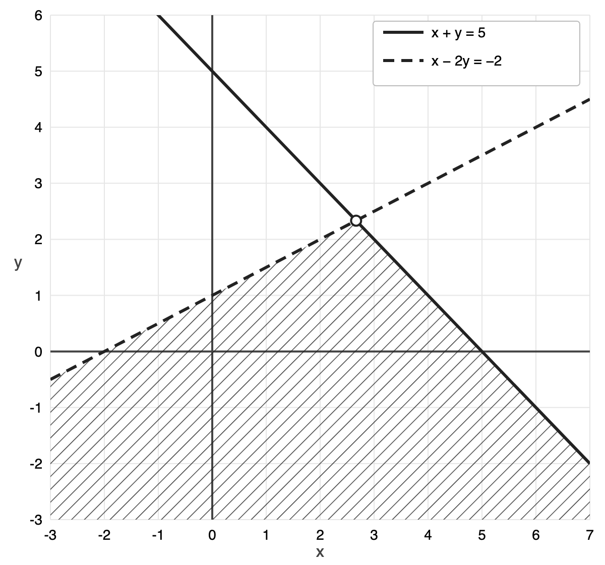

# Examen de ecuaciones, inecuaciones y binomio de Newton

### Ejercicio 1 (0,75 puntos) - Fracciones algebraicas

Opera y simplifica: $\left(\dfrac{1}{x} + \dfrac{2}{x + 1}\right) \cdot \dfrac{x + 1}{x} - \dfrac{x - 1}{x}\left(2 - \dfrac{3}{x - 1}\right)$

### Ejercicio 2 (0,75 puntos) - Ecuación de segundo grado

Resuelve: $\dfrac{x^2 - 1}{2} - \dfrac{x(x - 3)}{3} = \dfrac{2}{3}$

### Ejercicio 3 (0,5 puntos) - Ecuación bicuadrada

Resuelve: $4x^4 - 37x^2 + 9 = 0$

### Ejercicio 4 (0,75 puntos) - Ecuación racional

Resuelve y comprueba las soluciones: $\dfrac{x + 1}{x - 1} + \dfrac{x - 1}{x + 1} = \dfrac{10}{3}$

### Ejercicio 5 (0,75 puntos) - Ecuación irracional

Resuelve y comprueba las soluciones: $\sqrt{x + 5} = x - 1$

### Ejercicio 6 (0,75 puntos) - Ecuación logarítmica

Resuelve: $2\log x - \log(x - 16) = 2$

### Ejercicio 7 (0,75 puntos) - Ecuación exponencial

Resuelve: $3^{2x} - 4 \cdot 3^{x + 1} + 27 = 0$

### Ejercicio 8 (1 punto) - Sistema de ecuaciones logarítmicas

Resuelve: $\begin{cases} x + y = 20 \\ 2\log x - \log y = 1 \end{cases}$

### Ejercicio 9 (1 punto) - Sistema de ecuaciones exponenciales

Resuelve: $\begin{cases} 2^{x + 1} + 5^y = 41 \\ 3 \cdot 2^x - 5^{y + 1} = -101 \end{cases}$

### Ejercicio 10 (0,75 puntos) - Inecuaciones

- **a) (0,25p)** $x^2 - 4x - 5 \leq 0$
- **b) (0,5p)** $\dfrac{x^2 - x - 6}{x - 1} \geq 0$

### Ejercicio 11 (1,25 puntos) - Sistemas de inecuaciones

- **a) (0,5p)** $\begin{cases} 2x - 3 \geq x + 1 \\ 10 - 3x > -8 \end{cases}$
- **b) (0,75p)** $\begin{cases} x + y \leq 5 \\ x - 2y > -2 \end{cases}$

### Ejercicio 12 (1 punto) - Binomio de Newton

- **a) (0,5p)** Desarrolla $(2x - 1)^4$.
- **b) (0,5p)** Halla el término independiente del desarrollo de $\left(x^2 - \dfrac{2}{x}\right)^6$.

---

## Resolución

### Solución Ejercicio 1

Primer sumando: $\dfrac{1}{x} + \dfrac{2}{x + 1} = \dfrac{x + 1 + 2x}{x(x + 1)} = \dfrac{3x + 1}{x(x + 1)}$, que multiplicado por $\dfrac{x + 1}{x}$ da $\dfrac{3x + 1}{x^2}$.

Segundo sumando: $2 - \dfrac{3}{x - 1} = \dfrac{2x - 5}{x - 1}$, que multiplicado por $\dfrac{x - 1}{x}$ da $\dfrac{2x - 5}{x}$.

$$\frac{3x + 1}{x^2} - \frac{2x - 5}{x} = \frac{3x + 1 - x(2x - 5)}{x^2} = \frac{-2x^2 + 8x + 1}{x^2}$$

### Solución Ejercicio 2

Multiplicamos por $6$:

$$3(x^2 - 1) - 2x(x - 3) = 4 \implies 3x^2 - 3 - 2x^2 + 6x = 4 \implies x^2 + 6x - 7 = 0$$

$$x = \frac{-6 \pm \sqrt{36 + 28}}{2} = \frac{-6 \pm 8}{2} \implies x = 1, \ x = -7$$

### Solución Ejercicio 3

Cambio $t = x^2$: $4t^2 - 37t + 9 = 0$.

$$t = \frac{37 \pm \sqrt{1369 - 144}}{8} = \frac{37 \pm 35}{8} \implies t = 9, \ t = \frac{1}{4}$$

Deshacemos el cambio: $x^2 = 9 \implies x = \pm 3$ y $x^2 = \dfrac{1}{4} \implies x = \pm\dfrac{1}{2}$.

Soluciones: $x = -3, \ -\dfrac{1}{2}, \ \dfrac{1}{2}, \ 3$.

### Solución Ejercicio 4

Denominador común $(x - 1)(x + 1)$:

$$(x + 1)^2 + (x - 1)^2 = \frac{10}{3}(x^2 - 1) \implies 2x^2 + 2 = \frac{10}{3}(x^2 - 1) \implies 6x^2 + 6 = 10x^2 - 10 \implies x^2 = 4$$

Comprobación: $x = 2$ y $x = -2$ no anulan ningún denominador y verifican la ecuación (con $x = 2$: $3 + \frac{1}{3} = \frac{10}{3}$; con $x = -2$: $\frac{1}{3} + 3 = \frac{10}{3}$).

Soluciones: $x = 2$ y $x = -2$.

### Solución Ejercicio 5

Elevamos al cuadrado: $x + 5 = (x - 1)^2 \implies x + 5 = x^2 - 2x + 1 \implies x^2 - 3x - 4 = 0 \implies x = 4, \ x = -1$.

- $x = 4$: $\sqrt{9} = 3 = 4 - 1$. Válida.
- $x = -1$: $\sqrt{4} = 2 \neq -2$. No válida.

Solución: $x = 4$.

### Solución Ejercicio 6

Agrupamos con las propiedades de los logaritmos y escribimos $2 = \log 100$:

$$\log\frac{x^2}{x - 16} = \log 100 \implies x^2 = 100(x - 16) \implies x^2 - 100x + 1600 = 0$$

$$x = \frac{100 \pm \sqrt{10000 - 6400}}{2} = \frac{100 \pm 60}{2} \implies x = 80, \ x = 20$$

Los dos valores cumplen $x > 16$, así que los argumentos son positivos y ambos son válidos.

Soluciones: $x = 20$ y $x = 80$.

### Solución Ejercicio 7

Con $t = 3^x$ tenemos $3^{2x} = t^2$ y $3^{x + 1} = 3t$:

$$t^2 - 12t + 27 = 0 \implies t = \frac{12 \pm 6}{2} \implies t = 9, \ t = 3$$

- $3^x = 9 \implies x = 2$.
- $3^x = 3 \implies x = 1$.

Soluciones: $x = 1$ y $x = 2$.

### Solución Ejercicio 8

De la segunda ecuación: $\log\dfrac{x^2}{y} = \log 10 \implies x^2 = 10y$. De la primera, $y = 20 - x$:

$$x^2 = 10(20 - x) \implies x^2 + 10x - 200 = 0 \implies x = \frac{-10 \pm 30}{2} \implies x = 10, \ x = -20$$

Con $x = -20$ el logaritmo no existe. Con $x = 10$ se tiene $y = 10$ y comprobamos: $2\log 10 - \log 10 = 1$.

Solución: $x = 10$, $y = 10$.

### Solución Ejercicio 9

Con $a = 2^x$ y $b = 5^y$ tenemos $2^{x + 1} = 2a$ y $5^{y + 1} = 5b$:

$$\begin{cases} 2a + b = 41 \\ 3a - 5b = -101 \end{cases}$$

De la primera, $b = 41 - 2a$. En la segunda: $3a - 205 + 10a = -101 \implies 13a = 104 \implies a = 8$, y $b = 25$.

$2^x = 8 \implies x = 3$ y $5^y = 25 \implies y = 2$.

Solución: $x = 3$, $y = 2$.

### Solución Ejercicio 10

**a)** Raíces: $x^2 - 4x - 5 = 0 \implies (x - 5)(x + 1) = 0 \implies x = -1, \ x = 5$. La parábola es negativa entre las raíces y se anula en ellas.

Solución: $x \in [-1, 5]$.

**b)** Numerador: $x^2 - x - 6 = (x - 3)(x + 2)$, con raíces $-2$ y $3$. El denominador se anula en $x = 1$ (no pertenece a la solución). Estudiamos el signo:

- $(-\infty, -2)$: con $x = -3$, $\dfrac{6}{-4} < 0$. No cumple.
- $(-2, 1)$: con $x = 0$, $\dfrac{-6}{-1} > 0$. Cumple.
- $(1, 3)$: con $x = 2$, $\dfrac{-4}{1} < 0$. No cumple.
- $(3, +\infty)$: con $x = 4$, $\dfrac{6}{3} > 0$. Cumple.

Los ceros del numerador sí se incluyen. Solución: $x \in [-2, 1) \cup [3, +\infty)$.

### Solución Ejercicio 11

**a)** Primera: $x \geq 4$. Segunda: $-3x > -18 \implies x < 6$.

Solución: $x \in [4, 6)$.

**b)** Primera inecuación: recta $x + y = 5$ (continua), que pasa por $(5, 0)$ y $(0, 5)$. El origen cumple $0 \leq 5$: semiplano que contiene al origen.

Segunda inecuación: recta $x - 2y = -2$ (discontinua, desigualdad estricta), que pasa por $(-2, 0)$ y $(0, 1)$. El origen cumple $0 > -2$: semiplano que contiene al origen.

La solución es la región no acotada situada bajo las dos rectas, con vértice en su punto de corte $\left(\dfrac{8}{3}, \dfrac{7}{3}\right)$. Ese vértice no pertenece a la región, porque está sobre la recta discontinua.

### Solución Ejercicio 12

**a)** Coeficientes de la fila $4$ del triángulo de Pascal: $1, 4, 6, 4, 1$.

$$(2x - 1)^4 = (2x)^4 - 4(2x)^3 + 6(2x)^2 - 4(2x) + 1 = 16x^4 - 32x^3 + 24x^2 - 8x + 1$$

**b)** Término general:

$$T_{k+1} = \binom{6}{k}(x^2)^{6 - k}\left(-\frac{2}{x}\right)^k = \binom{6}{k}(-2)^k x^{12 - 3k}$$

Es independiente de $x$ si $12 - 3k = 0 \implies k = 4$:

$$T_5 = \binom{6}{4}(-2)^4 = 15 \cdot 16 = 240$$
