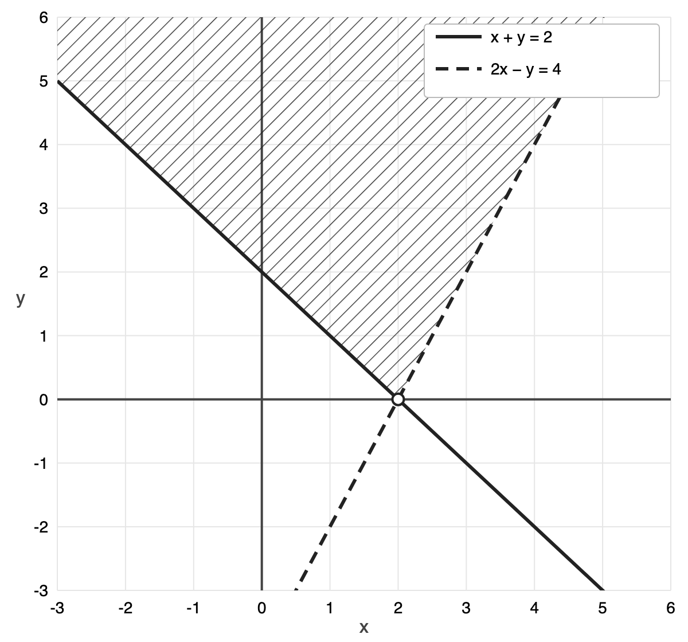

# Examen de ecuaciones, inecuaciones y binomio de Newton

### Ejercicio 1 (0,75 puntos) - Fracciones algebraicas

Opera y simplifica: $\left(\dfrac{2}{x} - \dfrac{1}{x - 1}\right) \cdot \dfrac{x - 1}{x} + \dfrac{x + 1}{x}\left(1 - \dfrac{2}{x + 1}\right)$

### Ejercicio 2 (0,75 puntos) - Ecuación de segundo grado

Resuelve: $\dfrac{x(x + 2)}{3} - \dfrac{x^2 - 4}{4} = \dfrac{7}{4}$

### Ejercicio 3 (0,5 puntos) - Ecuación bicuadrada

Resuelve: $4x^4 - 65x^2 + 16 = 0$

### Ejercicio 4 (0,75 puntos) - Ecuación racional

Resuelve y comprueba las soluciones: $\dfrac{x + 1}{x - 2} - \dfrac{x - 1}{x + 2} = 2$

### Ejercicio 5 (0,75 puntos) - Ecuación irracional

Resuelve y comprueba las soluciones: $\sqrt{x - 1} = x - 3$

### Ejercicio 6 (0,75 puntos) - Ecuación logarítmica

Resuelve: $2\log x - \log(x - 9) = 2$

### Ejercicio 7 (0,75 puntos) - Ecuación exponencial

Resuelve: $4^x - 3 \cdot 2^{x + 2} + 32 = 0$

### Ejercicio 8 (1 punto) - Sistema de ecuaciones logarítmicas

Resuelve: $\begin{cases} \log x + \log y = 2 \\ x - y = 15 \end{cases}$

### Ejercicio 9 (1 punto) - Sistema de ecuaciones exponenciales

Resuelve: $\begin{cases} 2^{x + 1} + 3^{y - 1} = 17 \\ 5 \cdot 2^x - 3^y = -7 \end{cases}$

### Ejercicio 10 (0,75 puntos) - Inecuaciones

- **a) (0,25p)** $x^2 + 2x - 8 > 0$
- **b) (0,5p)** $\dfrac{x^2 - x - 2}{x - 3} \leq 0$

### Ejercicio 11 (1,25 puntos) - Sistemas de inecuaciones

- **a) (0,5p)** $\begin{cases} 3x - 5 \leq x + 3 \\ 4 - 3x < 7 \end{cases}$
- **b) (0,75p)** $\begin{cases} x + y \geq 2 \\ 2x - y < 4 \end{cases}$

### Ejercicio 12 (1 punto) - Binomio de Newton

- **a) (0,5p)** Desarrolla $(3x - 2)^4$.
- **b) (0,5p)** Halla el término independiente del desarrollo de $\left(x^2 + \dfrac{1}{x}\right)^9$.

---

## Resolución

### Solución Ejercicio 1

Primer sumando: $\dfrac{2}{x} - \dfrac{1}{x - 1} = \dfrac{2(x - 1) - x}{x(x - 1)} = \dfrac{x - 2}{x(x - 1)}$, que multiplicado por $\dfrac{x - 1}{x}$ da $\dfrac{x - 2}{x^2}$.

Segundo sumando: $1 - \dfrac{2}{x + 1} = \dfrac{x - 1}{x + 1}$, que multiplicado por $\dfrac{x + 1}{x}$ da $\dfrac{x - 1}{x}$.

$$\frac{x - 2}{x^2} + \frac{x - 1}{x} = \frac{x - 2 + x(x - 1)}{x^2} = \frac{x^2 - 2}{x^2}$$

### Solución Ejercicio 2

Multiplicamos por $12$:

$$4x(x + 2) - 3(x^2 - 4) = 21 \implies 4x^2 + 8x - 3x^2 + 12 = 21 \implies x^2 + 8x - 9 = 0$$

$$x = \frac{-8 \pm \sqrt{64 + 36}}{2} = \frac{-8 \pm 10}{2} \implies x = 1, \ x = -9$$

### Solución Ejercicio 3

Cambio $t = x^2$: $4t^2 - 65t + 16 = 0$.

$$t = \frac{65 \pm \sqrt{4225 - 256}}{8} = \frac{65 \pm 63}{8} \implies t = 16, \ t = \frac{1}{4}$$

Deshacemos el cambio: $x^2 = 16 \implies x = \pm 4$ y $x^2 = \dfrac{1}{4} \implies x = \pm\dfrac{1}{2}$.

Soluciones: $x = -4, \ -\dfrac{1}{2}, \ \dfrac{1}{2}, \ 4$.

### Solución Ejercicio 4

Denominador común $(x - 2)(x + 2)$:

$$(x + 1)(x + 2) - (x - 1)(x - 2) = 2(x^2 - 4) \implies 6x = 2x^2 - 8 \implies x^2 - 3x - 4 = 0 \implies x = 4, \ x = -1$$

Comprobación: ninguno de los dos valores anula un denominador.

- $x = 4$: $\dfrac{5}{2} - \dfrac{3}{6} = 2$. Válida.
- $x = -1$: $0 - \dfrac{-2}{1} = 2$. Válida.

Soluciones: $x = -1$ y $x = 4$.

### Solución Ejercicio 5

Elevamos al cuadrado: $x - 1 = (x - 3)^2 \implies x - 1 = x^2 - 6x + 9 \implies x^2 - 7x + 10 = 0 \implies x = 5, \ x = 2$.

- $x = 5$: $\sqrt{4} = 2 = 5 - 3$. Válida.
- $x = 2$: $\sqrt{1} = 1 \neq -1$. No válida.

Solución: $x = 5$.

### Solución Ejercicio 6

Agrupamos con las propiedades de los logaritmos y escribimos $2 = \log 100$:

$$\log\frac{x^2}{x - 9} = \log 100 \implies x^2 = 100(x - 9) \implies x^2 - 100x + 900 = 0$$

$$x = \frac{100 \pm \sqrt{10000 - 3600}}{2} = \frac{100 \pm 80}{2} \implies x = 90, \ x = 10$$

Los dos valores cumplen $x > 9$, así que los argumentos son positivos y ambos son válidos.

Soluciones: $x = 10$ y $x = 90$.

### Solución Ejercicio 7

Con $t = 2^x$ tenemos $4^x = t^2$ y $2^{x + 2} = 4t$:

$$t^2 - 12t + 32 = 0 \implies t = \frac{12 \pm 4}{2} \implies t = 8, \ t = 4$$

- $2^x = 8 \implies x = 3$.
- $2^x = 4 \implies x = 2$.

Soluciones: $x = 2$ y $x = 3$.

### Solución Ejercicio 8

De la primera ecuación: $\log(xy) = \log 100 \implies xy = 100$. De la segunda, $x = y + 15$:

$$(y + 15)y = 100 \implies y^2 + 15y - 100 = 0 \implies y = \frac{-15 \pm 25}{2} \implies y = 5, \ y = -20$$

Con $y = -20$ el logaritmo no existe. Con $y = 5$ se tiene $x = 20$ y comprobamos: $\log 20 + \log 5 = \log 100 = 2$.

Solución: $x = 20$, $y = 5$.

### Solución Ejercicio 9

Con $a = 2^x$ y $b = 3^y$ tenemos $2^{x + 1} = 2a$ y $3^{y - 1} = \dfrac{b}{3}$:

$$\begin{cases} 2a + \dfrac{b}{3} = 17 \\ 5a - b = -7 \end{cases} \implies \begin{cases} 6a + b = 51 \\ 5a - b = -7 \end{cases}$$

Sumando: $11a = 44 \implies a = 4$, y $b = 51 - 24 = 27$.

$2^x = 4 \implies x = 2$ y $3^y = 27 \implies y = 3$.

Solución: $x = 2$, $y = 3$.

### Solución Ejercicio 10

**a)** Raíces: $x^2 + 2x - 8 = 0 \implies (x + 4)(x - 2) = 0 \implies x = -4, \ x = 2$. La parábola es positiva fuera de las raíces y la desigualdad es estricta.

Solución: $x \in (-\infty, -4) \cup (2, +\infty)$.

**b)** Numerador: $x^2 - x - 2 = (x - 2)(x + 1)$, con raíces $-1$ y $2$. El denominador se anula en $x = 3$ (no pertenece a la solución). Estudiamos el signo:

- $(-\infty, -1)$: con $x = -2$, $\dfrac{4}{-5} < 0$. Cumple.
- $(-1, 2)$: con $x = 0$, $\dfrac{-2}{-3} > 0$. No cumple.
- $(2, 3)$: con $x = 2{,}5$, el numerador es positivo y el denominador negativo. Cumple.
- $(3, +\infty)$: con $x = 4$, $\dfrac{10}{1} > 0$. No cumple.

Los ceros del numerador sí se incluyen. Solución: $x \in (-\infty, -1] \cup [2, 3)$.

### Solución Ejercicio 11

**a)** Primera: $2x \leq 8 \implies x \leq 4$. Segunda: $-3x < 3 \implies x > -1$.

Solución: $x \in (-1, 4]$.

**b)** Primera inecuación: recta $x + y = 2$ (continua), que pasa por $(2, 0)$ y $(0, 2)$. El origen no cumple $0 \geq 2$: semiplano que no contiene al origen.

Segunda inecuación: recta $2x - y = 4$ (discontinua, desigualdad estricta), que pasa por $(2, 0)$ y $(0, -4)$. El origen cumple $0 < 4$: semiplano que contiene al origen.

La solución es la región no acotada situada sobre las dos rectas, con vértice en su punto de corte $(2, 0)$. Ese vértice no pertenece a la región, porque está sobre la recta discontinua.

### Solución Ejercicio 12

**a)** Coeficientes de la fila $4$ del triángulo de Pascal: $1, 4, 6, 4, 1$.

$$(3x - 2)^4 = (3x)^4 - 4(3x)^3 \cdot 2 + 6(3x)^2 \cdot 4 - 4(3x) \cdot 8 + 16 = 81x^4 - 216x^3 + 216x^2 - 96x + 16$$

**b)** Término general:

$$T_{k+1} = \binom{9}{k}(x^2)^{9 - k}\left(\frac{1}{x}\right)^k = \binom{9}{k}x^{18 - 3k}$$

Es independiente de $x$ si $18 - 3k = 0 \implies k = 6$:

$$T_7 = \binom{9}{6} = 84$$
