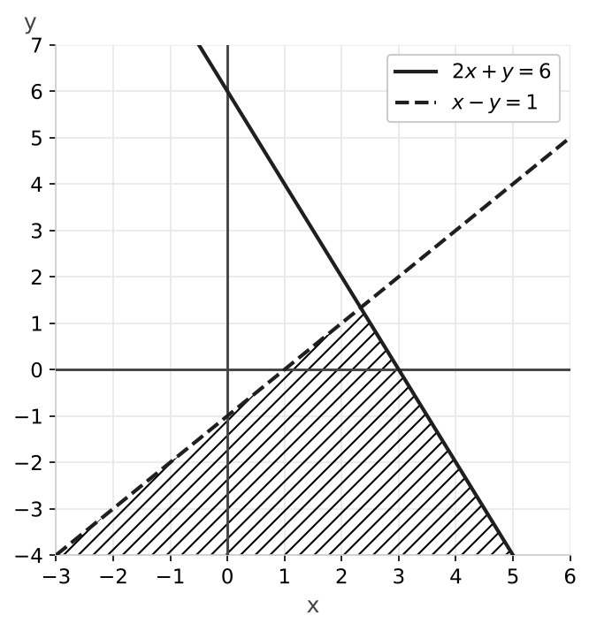

# Examen de operaciones, ecuaciones e inecuaciones

### Ejercicio 1 (2 puntos) - Operaciones con números reales y logaritmos

- **a) (0,5p)** Calcula y simplifica: $\left(\dfrac{5}{3} - \dfrac{1}{2} \cdot \dfrac{3}{4}\right) : \left(\dfrac{2}{3} + \dfrac{1}{6}\right)$
- **b) (0,5p)** Simplifica: $\dfrac{27^3 \cdot 9^{-2}}{3^4 \cdot 81^{-1}}$
- **c) (0,5p)** Simplifica al máximo: $\dfrac{\sqrt{x \cdot \sqrt[3]{x^2}}}{\sqrt[4]{x^3}}$
- **d) (0,5p)** Halla el valor exacto de $x$ sin usar la calculadora: $\log_3 x = 2\log_3 6 - \dfrac{1}{2}\log_3 16 + \log_3 2$

### Ejercicio 2 (1,5 puntos) - Factorización de polinomios

Factoriza al máximo el polinomio $P(x) = 2x^4 - 4x^3 - 14x^2 + 16x + 24$.

### Ejercicio 3 (1,5 puntos) - Fracciones algebraicas

Opera y simplifica: $\left(\dfrac{x + 1}{x^2 - 4} - \dfrac{1}{x - 2}\right) : \dfrac{3}{x + 2}$

### Ejercicio 4 (2 puntos) - Ecuaciones y sistemas

- **a) (1p)** $\sqrt{2x + 5} + 1 = x$
- **b) (1p)** $\begin{cases} x^2 - y^2 = 9 \\ x + y = 9 \end{cases}$

### Ejercicio 5 (3 puntos) - Inecuaciones y sistemas de inecuaciones

- **a) (1p)** $x^2 - 4x - 5 \leq 0$
- **b) (1p)** $\begin{cases} 2x - 4 > 0 \\ 5 - x \geq 1 \end{cases}$
- **c) (1p)** $\begin{cases} 2x + y \leq 6 \\ x - y > 1 \end{cases}$

---

## Resolución

### Solución Ejercicio 1

**a)** Primero la multiplicación del primer paréntesis: $\dfrac{1}{2} \cdot \dfrac{3}{4} = \dfrac{3}{8}$

Restamos con $\text{m.c.m.}(3, 8) = 24$: $\dfrac{5}{3} - \dfrac{3}{8} = \dfrac{40 - 9}{24} = \dfrac{31}{24}$

Sumamos el segundo paréntesis: $\dfrac{2}{3} + \dfrac{1}{6} = \dfrac{4 + 1}{6} = \dfrac{5}{6}$

$$\frac{31}{24} : \frac{5}{6} = \frac{31 \cdot 6}{24 \cdot 5} = \frac{31}{20}$$

**b)** Escribimos todo en base $3$: $27 = 3^3$, $9 = 3^2$, $81 = 3^4$.

$$\frac{(3^3)^3 \cdot (3^2)^{-2}}{3^4 \cdot (3^4)^{-1}} = \frac{3^9 \cdot 3^{-4}}{3^4 \cdot 3^{-4}} = \frac{3^5}{3^0} = 3^5 = 243$$

**c)** Pasamos las raíces a potencias de exponente fraccionario:

$$\frac{\left(x \cdot x^{2/3}\right)^{1/2}}{x^{3/4}} = \frac{\left(x^{5/3}\right)^{1/2}}{x^{3/4}} = \frac{x^{5/6}}{x^{3/4}} = x^{\frac{5}{6} - \frac{3}{4}} = x^{\frac{1}{12}} = \sqrt[12]{x}$$

**d)** Subimos los coeficientes como exponentes: $2\log_3 6 = \log_3 36$ y $\dfrac{1}{2}\log_3 16 = \log_3 \sqrt{16} = \log_3 4$.

Las restas pasan a división y las sumas a producto:

$$\log_3 x = \log_3 \frac{36 \cdot 2}{4} = \log_3 18 \implies x = 18$$

### Solución Ejercicio 2

Sacamos factor común $2$: $P(x) = 2(x^4 - 2x^3 - 7x^2 + 8x + 12)$.

Las posibles raíces enteras son los divisores de $12$. Probando con Ruffini encontramos las raíces $-1$, $2$, $-2$ y $3$:

$$P(x) = 2(x + 1)(x - 2)(x + 2)(x - 3)$$

### Solución Ejercicio 3

Factorizamos: $x^2 - 4 = (x - 2)(x + 2)$. Operamos el paréntesis con denominador común $(x - 2)(x + 2)$:

$$\frac{x + 1}{(x - 2)(x + 2)} - \frac{x + 2}{(x - 2)(x + 2)} = \frac{x + 1 - x - 2}{(x - 2)(x + 2)} = \frac{-1}{(x - 2)(x + 2)}$$

Dividimos multiplicando por la fracción inversa y simplificamos $(x + 2)$:

$$\frac{-1}{(x - 2)(x + 2)} \cdot \frac{x + 2}{3} = \frac{-1}{3(x - 2)} = \frac{-1}{3x - 6}$$

### Solución Ejercicio 4

**a)** Dejamos la raíz sola y elevamos al cuadrado:

$$\sqrt{2x + 5} = x - 1 \implies 2x + 5 = x^2 - 2x + 1 \implies x^2 - 4x - 4 = 0$$

$$x = \frac{4 \pm \sqrt{16 + 16}}{2} = \frac{4 \pm 4\sqrt{2}}{2} = 2 \pm 2\sqrt{2}$$

Al elevar al cuadrado pueden aparecer soluciones falsas, así que comprobamos:

- $x = 2 + 2\sqrt{2} \approx 4{,}83$: $\sqrt{14{,}66} + 1 \approx 3{,}83 + 1 = 4{,}83$. Válida.
- $x = 2 - 2\sqrt{2} \approx -0{,}83$: $\sqrt{3{,}34} + 1 \approx 2{,}83 \neq -0{,}83$. No válida.

La única solución es $x = 2 + 2\sqrt{2}$.

**b)** Como $x^2 - y^2 = (x - y)(x + y)$ y $x + y = 9$:

$$(x - y) \cdot 9 = 9 \implies x - y = 1$$

Resolvemos $x + y = 9$, $x - y = 1$: sumando, $2x = 10 \implies x = 5$, y $y = 4$.

Solución: $(x, y) = (5, 4)$.

### Solución Ejercicio 5

**a)** Raíces: $x^2 - 4x - 5 = 0 \implies (x - 5)(x + 1) = 0 \implies x = -1, \ x = 5$.

Probamos un valor en cada intervalo:

- $(-\infty, -1)$: con $x = -2$, $4 + 8 - 5 = 7 > 0$. No cumple.
- $(-1, 5)$: con $x = 0$, $-5 \leq 0$. Cumple.
- $(5, +\infty)$: con $x = 6$, $36 - 24 - 5 = 7 > 0$. No cumple.

Los extremos cumplen la igualdad. Solución: $x \in [-1, 5]$.

**b)** Primera: $2x > 4 \implies x > 2$. Segunda: $4 \geq x \implies x \leq 4$.

La solución es la intersección: $x \in (2, 4]$.

**c)** Primera inecuación: dibujamos la recta $2x + y = 6$ (continua, porque incluye la igualdad), que pasa por $(0, 6)$ y $(3, 0)$. El origen cumple $0 \leq 6$, así que la solución es el semiplano que contiene al origen.

Segunda inecuación: dibujamos la recta $x - y = 1$ (discontinua, porque la desigualdad es estricta), que pasa por $(1, 0)$ y $(0, -1)$. El origen no cumple $0 > 1$, así que la solución es el semiplano que no contiene al origen.

La solución es la región rayada, intersección de los dos semiplanos. Es una región no acotada con vértice en el punto de corte de las rectas, $\left(\frac{7}{3}, \frac{4}{3}\right)$.

