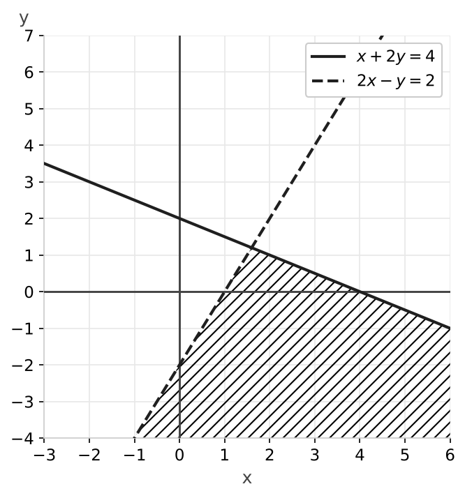

# Examen de operaciones, ecuaciones e inecuaciones

### Ejercicio 1 (2 puntos) - Operaciones con números reales y logaritmos

- **a) (0,5p)** Calcula y simplifica: $\left(\dfrac{7}{4} - \dfrac{2}{3} \cdot \dfrac{9}{8}\right) : \left(\dfrac{5}{6} - \dfrac{1}{3}\right)$
- **b) (0,5p)** Simplifica: $\dfrac{125^2 \cdot 5^{-3}}{25^3 \cdot 625^{-1}}$
- **c) (0,5p)** Simplifica al máximo: $\dfrac{\sqrt[3]{x^2 \cdot \sqrt{x}}}{\sqrt[6]{x^5}}$
- **d) (0,5p)** Halla el valor exacto de $x$ sin usar la calculadora: $\log_2 x = 3\log_2 4 - \dfrac{1}{3}\log_2 27 - \log_2 3$

### Ejercicio 2 (1,5 puntos) - Factorización de polinomios

Factoriza al máximo el polinomio $P(x) = x^4 - 3x^3 - 3x^2 + 11x - 6$.

### Ejercicio 3 (1,5 puntos) - Fracciones algebraicas

Opera y simplifica: $\left(\dfrac{2x - 1}{x^2 - 9} + \dfrac{1}{x + 3}\right) : \dfrac{3}{x - 3}$

### Ejercicio 4 (2 puntos) - Ecuaciones y sistemas

- **a) (1p)** $\sqrt{3x + 1} - 1 = x$
- **b) (1p)** $\begin{cases} x^2 + y^2 = 25 \\ x - y = 1 \end{cases}$

### Ejercicio 5 (3 puntos) - Inecuaciones y sistemas de inecuaciones

- **a) (1p)** $x^2 - 2x - 8 \geq 0$
- **b) (1p)** $\begin{cases} 3x - 6 > 0 \\ 8 - 2x \geq 2 \end{cases}$
- **c) (1p)** $\begin{cases} x + 2y \leq 4 \\ 2x - y > 2 \end{cases}$

---

## Resolución

### Solución Ejercicio 1

**a)** Multiplicación del primer paréntesis: $\dfrac{2}{3} \cdot \dfrac{9}{8} = \dfrac{18}{24} = \dfrac{3}{4}$. Resta: $\dfrac{7}{4} - \dfrac{3}{4} = 1$.

Segundo paréntesis, con $\text{m.c.m.} = 6$: $\dfrac{5}{6} - \dfrac{2}{6} = \dfrac{3}{6} = \dfrac{1}{2}$.

$$1 : \frac{1}{2} = 2$$

**b)** Escribimos todo en base $5$: $125 = 5^3$, $25 = 5^2$, $625 = 5^4$.

$$\frac{(5^3)^2 \cdot 5^{-3}}{(5^2)^3 \cdot (5^4)^{-1}} = \frac{5^6 \cdot 5^{-3}}{5^6 \cdot 5^{-4}} = \frac{5^3}{5^2} = 5$$

**c)** Pasamos a exponentes fraccionarios:

$$\frac{\left(x^2 \cdot x^{1/2}\right)^{1/3}}{x^{5/6}} = \frac{\left(x^{5/2}\right)^{1/3}}{x^{5/6}} = \frac{x^{5/6}}{x^{5/6}} = 1$$

**d)** Subimos los coeficientes como exponentes: $3\log_2 4 = \log_2 4^3 = \log_2 64$ y $\dfrac{1}{3}\log_2 27 = \log_2 \sqrt[3]{27} = \log_2 3$.

$$\log_2 x = \log_2 64 - \log_2 3 - \log_2 3 = \log_2 \frac{64}{3 \cdot 3} = \log_2 \frac{64}{9} \implies x = \frac{64}{9}$$

### Solución Ejercicio 2

Las posibles raíces enteras son los divisores de $6$. Por Ruffini encontramos $x = 1$ (dos veces), $x = -2$ y $x = 3$:

$$P(x) = (x - 1)^2 (x + 2)(x - 3)$$

$x = 1$ es una raíz doble.

### Solución Ejercicio 3

Factorizamos: $x^2 - 9 = (x - 3)(x + 3)$. Operamos el paréntesis con denominador común $(x - 3)(x + 3)$:

$$\frac{2x - 1}{(x - 3)(x + 3)} + \frac{x - 3}{(x - 3)(x + 3)} = \frac{3x - 4}{(x - 3)(x + 3)}$$

Dividimos multiplicando por la inversa y simplificamos $(x - 3)$:

$$\frac{3x - 4}{(x - 3)(x + 3)} \cdot \frac{x - 3}{3} = \frac{3x - 4}{3(x + 3)} = \frac{3x - 4}{3x + 9}$$

### Solución Ejercicio 4

**a)** Dejamos la raíz sola y elevamos al cuadrado:

$$\sqrt{3x + 1} = x + 1 \implies 3x + 1 = x^2 + 2x + 1 \implies x^2 - x = 0 \implies x(x - 1) = 0$$

Comprobamos las dos posibles soluciones:

- $x = 0$: $\sqrt{1} - 1 = 0$. Válida.
- $x = 1$: $\sqrt{4} - 1 = 1$. Válida.

Soluciones: $x = 0$ y $x = 1$.

**b)** Despejamos $x = y + 1$ y sustituimos en la primera ecuación:

$$(y + 1)^2 + y^2 = 25 \implies 2y^2 + 2y - 24 = 0 \implies y^2 + y - 12 = 0 \implies (y + 4)(y - 3) = 0$$

- Si $y = -4$: $x = -3$.
- Si $y = 3$: $x = 4$.

Soluciones: $(-3, -4)$ y $(4, 3)$.

### Solución Ejercicio 5

**a)** Raíces: $x^2 - 2x - 8 = 0 \implies (x - 4)(x + 2) = 0 \implies x = -2, \ x = 4$.

- $(-\infty, -2)$: con $x = -3$, $9 + 6 - 8 = 7 \geq 0$. Cumple.
- $(-2, 4)$: con $x = 0$, $-8$. No cumple.
- $(4, +\infty)$: con $x = 5$, $25 - 10 - 8 = 7 \geq 0$. Cumple.

Los extremos cumplen la igualdad. Solución: $x \in (-\infty, -2] \cup [4, +\infty)$.

**b)** Primera: $3x > 6 \implies x > 2$. Segunda: $6 \geq 2x \implies x \leq 3$.

Solución: $x \in (2, 3]$.

**c)** Primera inecuación: recta $x + 2y = 4$ (continua), que pasa por $(0, 2)$ y $(4, 0)$. El origen cumple $0 \leq 4$: semiplano que contiene al origen.

Segunda inecuación: recta $2x - y = 2$ (discontinua, desigualdad estricta), que pasa por $(1, 0)$ y $(0, -2)$. El origen no cumple $0 > 2$: semiplano que no contiene al origen.

La solución es la región rayada, no acotada, con vértice en el punto de corte de las rectas, $\left(\frac{8}{5}, \frac{6}{5}\right)$.

