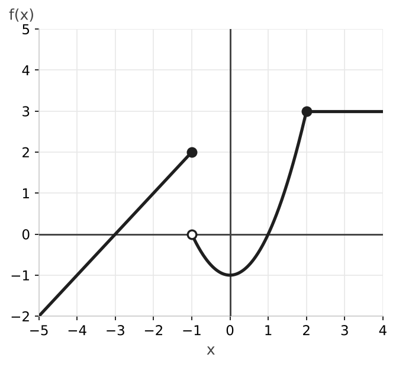
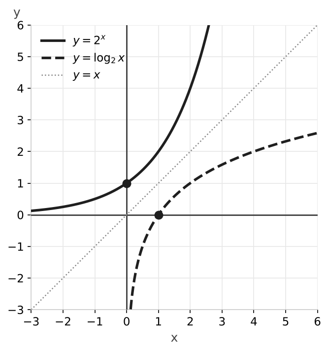

# Examen de funciones

### Ejercicio 1 (2 puntos) - Dominios

Calcula el dominio de las siguientes funciones:

- **a) (0,5p)** $f(x) = -2x^3 + 5x - 1$
- **b) (0,5p)** $g(x) = \dfrac{2x - 4}{3x - 9}$
- **c) (0,5p)** $h(x) = \sqrt{20 - 4x}$
- **d) (0,5p)** $k(x) = \sqrt{x^2 - 5x + 6}$

### Ejercicio 2 (1 punto) - Simetría

Estudia la simetría de las siguientes funciones:

- **a) (0,5p)** $f(x) = \dfrac{x^2}{x^3 + x}$
- **b) (0,5p)** $g(x) = 3x^4 - x^2 + 5$

### Ejercicio 3 (2 puntos) - Función definida a trozos

Representa gráficamente la siguiente función y estudia su continuidad:

$$f(x) = \begin{cases} x + 3 & \text{si } x \leq -1 \\ x^2 - 1 & \text{si } -1 < x < 2 \\ 3 & \text{si } x \geq 2 \end{cases}$$

### Ejercicio 4 (1 punto) - Composición de funciones

Dadas las funciones $f(x) = \dfrac{3x}{x + 2}$ y $g(x) = \dfrac{x - 1}{x}$, halla $(g \circ f)(x)$.

### Ejercicio 5 (1,5 puntos) - Función inversa

Dada la función $f(x) = \dfrac{2x}{3x + 4}$, calcula su inversa $f^{-1}(x)$ y comprueba que $(f \circ f^{-1})(x) = x$.

### Ejercicio 6 (1,5 puntos) - Funciones exponencial y logarítmica

Representa gráficamente las funciones $f(x) = 2^x$ y $g(x) = \log_2 x$. Indica su dominio, recorrido, puntos de corte con los ejes y crecimiento. ¿Qué relación hay entre ellas?

### Ejercicio 7 (1 punto) - Función lineal

El coste de un servicio de mensajería depende de los kilómetros recorridos. Enviar un paquete a $20$ km cuesta $5$ € y a $50$ km cuesta $11$ €.

- **a) (0,5p)** Halla la función lineal que expresa el coste en función de los kilómetros.
- **b) (0,5p)** Calcula el coste de un envío a $150$ km.

---

## Resolución

### Solución Ejercicio 1

**a)** Es un polinomio, así que se puede calcular para cualquier número: $\text{Dom}(f) = \mathbb{R}$.

**b)** El denominador no puede ser cero: $3x - 9 = 0 \implies x = 3$. $\text{Dom}(g) = \mathbb{R} \setminus \{3\}$.

**c)** El radicando debe ser mayor o igual que cero: $20 - 4x \geq 0 \implies 20 \geq 4x \implies x \leq 5$. $\text{Dom}(h) = (-\infty, 5]$.

**d)** El radicando debe ser mayor o igual que cero: $x^2 - 5x + 6 \geq 0$. Las raíces de $x^2 - 5x + 6 = 0$ son $x = 2$ y $x = 3$. Probamos un valor en cada intervalo:

- En $(-\infty, 2)$: con $x = 0$ vale $6 > 0$, sirve.
- En $(2, 3)$: con $x = 2{,}5$ vale $-0{,}25 < 0$, no sirve.
- En $(3, +\infty)$: con $x = 4$ vale $2 > 0$, sirve.

Las raíces también sirven (el radicando vale $0$). $\text{Dom}(k) = (-\infty, 2] \cup [3, +\infty)$.

### Solución Ejercicio 2

**a)** Sustituimos $x$ por $-x$:

$$f(-x) = \frac{(-x)^2}{(-x)^3 + (-x)} = \frac{x^2}{-x^3 - x} = -\frac{x^2}{x^3 + x} = -f(x)$$

Es impar: su gráfica es simétrica respecto al origen.

**b)** $g(-x) = 3(-x)^4 - (-x)^2 + 5 = 3x^4 - x^2 + 5 = g(x)$

Es par: su gráfica es simétrica respecto al eje $Y$.

### Solución Ejercicio 3

Primer tramo: recta que llega hasta el punto $(-1, 2)$, incluido. Segundo tramo: parábola con vértice en $(0, -1)$ que va de $(-1, 0)$ (sin incluir) a $(2, 3)$ (sin incluir). Tercer tramo: recta horizontal $y = 3$ desde $x = 2$, incluido.

Cada tramo es continuo, así que solo hay que estudiar los puntos donde cambia la definición.

En $x = -1$: $f(-1) = -1 + 3 = 2$.

$$\lim_{x \to -1^-} f(x) = -1 + 3 = 2 \qquad \lim_{x \to -1^+} f(x) = (-1)^2 - 1 = 0$$

Los límites laterales son distintos: en $x = -1$ hay una discontinuidad de salto finito (el salto es de $2$ unidades).

En $x = 2$: $f(2) = 3$.

$$\lim_{x \to 2^-} f(x) = 2^2 - 1 = 3 \qquad \lim_{x \to 2^+} f(x) = 3$$

Los límites laterales coinciden con $f(2)$: la función es continua en $x = 2$.

Conclusión: $f$ es continua en $\mathbb{R} \setminus \{-1\}$.

### Solución Ejercicio 4

$$(g \circ f)(x) = g(f(x)) = \frac{\dfrac{3x}{x + 2} - 1}{\dfrac{3x}{x + 2}} = \frac{\dfrac{3x - (x + 2)}{x + 2}}{\dfrac{3x}{x + 2}} = \frac{2x - 2}{3x}$$

### Solución Ejercicio 5

Escribimos $y = \dfrac{2x}{3x + 4}$, intercambiamos $x$ e $y$ y despejamos $y$:

$$x = \frac{2y}{3y + 4} \implies x(3y + 4) = 2y \implies 3xy + 4x = 2y \implies 4x = 2y - 3xy = y(2 - 3x)$$

$$f^{-1}(x) = \frac{4x}{2 - 3x}$$

Comprobación:

$$(f \circ f^{-1})(x) = \frac{2 \cdot \dfrac{4x}{2 - 3x}}{3 \cdot \dfrac{4x}{2 - 3x} + 4} = \frac{\dfrac{8x}{2 - 3x}}{\dfrac{12x + 8 - 12x}{2 - 3x}} = \frac{8x}{8} = x$$

### Solución Ejercicio 6

$f(x) = 2^x$: dominio $\mathbb{R}$, recorrido $(0, +\infty)$. Corta al eje $Y$ en $(0, 1)$ y no corta al eje $X$ (asíntota horizontal $y = 0$). Es creciente.

$g(x) = \log_2 x$: dominio $(0, +\infty)$, recorrido $\mathbb{R}$. Corta al eje $X$ en $(1, 0)$ y no corta al eje $Y$ (asíntota vertical $x = 0$). Es creciente.

Son funciones inversas: el dominio de una es el recorrido de la otra y sus gráficas son simétricas respecto a la recta $y = x$.

### Solución Ejercicio 7

**a)** La recta pasa por $A(20, 5)$ y $B(50, 11)$. Su pendiente es:

$$m = \frac{11 - 5}{50 - 20} = \frac{6}{30} = 0{,}2$$

$$y - 5 = 0{,}2(x - 20) \implies y = 0{,}2x + 1$$

Cada kilómetro cuesta $0{,}20$ € y hay un coste fijo de $1$ €.

**b)** $y = 0{,}2 \cdot 150 + 1 = 31$ €.
