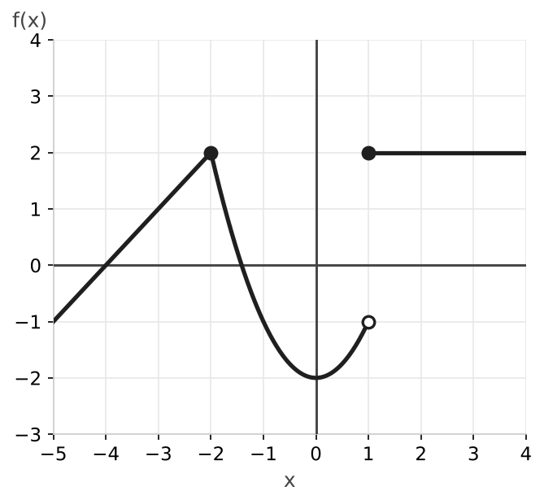
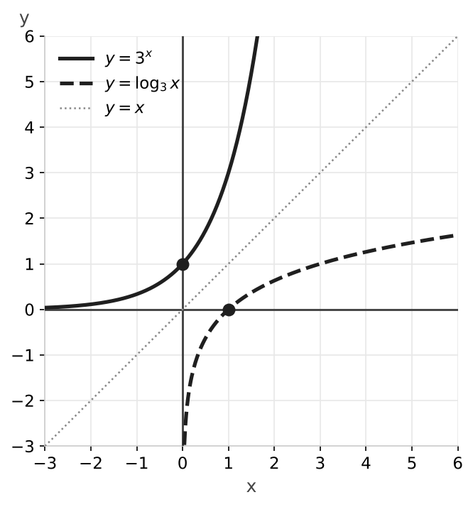

# Examen de funciones

### Ejercicio 1 (2 puntos) - Dominios

Calcula el dominio de las siguientes funciones:

- **a) (0,5p)** $f(x) = \dfrac{x^2 - 1}{x^2 - 7x + 12}$
- **b) (0,5p)** $g(x) = \sqrt{4x - 16}$
- **c) (0,5p)** $h(x) = \log(x + 8)$
- **d) (0,5p)** $i(x) = e^{3x - 2}$

### Ejercicio 2 (1 punto) - Simetría

Estudia la simetría de las siguientes funciones:

- **a) (0,5p)** $f(x) = x^6 - 3x^2 + 1$
- **b) (0,5p)** $g(x) = \dfrac{x^5}{x^2 + 4}$

### Ejercicio 3 (2 puntos) - Función definida a trozos

Representa gráficamente la siguiente función y estudia su continuidad:

$$f(x) = \begin{cases} x + 4 & \text{si } x < -2 \\ x^2 - 2 & \text{si } -2 \leq x < 1 \\ 2 & \text{si } x \geq 1 \end{cases}$$

### Ejercicio 4 (1 punto) - Composición de funciones

Dadas las funciones $f(x) = \dfrac{3}{x - 2}$ y $g(x) = \sqrt{x}$, halla $(f \circ g)(x)$ y $(g \circ f)(x)$.

### Ejercicio 5 (1,5 puntos) - Función inversa

Dada la función $f(x) = \dfrac{2x + 5}{x - 3}$, calcula su inversa $f^{-1}(x)$ y comprueba que $(f \circ f^{-1})(x) = x$.

### Ejercicio 6 (1,5 puntos) - Funciones exponencial y logarítmica

Representa gráficamente las funciones $f(x) = 3^x$ y $g(x) = \log_3 x$. Indica su dominio, recorrido, puntos de corte con los ejes y crecimiento. ¿Qué relación hay entre ellas?

### Ejercicio 7 (1 punto) - Función lineal

El coste de un servicio de alquiler de bicicletas depende de las horas de uso. Alquilarla $2$ horas cuesta $6$ € y alquilarla $5$ horas cuesta $12$ €.

- **a) (0,5p)** Halla la función lineal que expresa el coste $y$ en función de las horas $x$.
- **b) (0,5p)** Calcula el coste de un alquiler de $10$ horas.

---

## Resolución

### Solución Ejercicio 1

**a)** El denominador no puede ser cero:

$$x^2 - 7x + 12 = 0 \implies x = \frac{7 \pm \sqrt{49 - 48}}{2} = \frac{7 \pm 1}{2} \implies x = 4, \quad x = 3$$

$\text{Dom}(f) = \mathbb{R} \setminus \{3, 4\}$.

**b)** El radicando debe ser mayor o igual que cero: $4x - 16 \geq 0 \implies x \geq 4$. $\text{Dom}(g) = [4, +\infty)$.

**c)** El argumento del logaritmo debe ser positivo: $x + 8 > 0 \implies x > -8$. $\text{Dom}(h) = (-8, +\infty)$.

**d)** Una exponencial se puede calcular con cualquier exponente: $\text{Dom}(i) = \mathbb{R}$.

### Solución Ejercicio 2

Para estudiar la simetría sustituimos $x$ por $-x$ en general. Comprobarlo con un solo valor no basta: una función puede cumplir $f(1) = f(-1)$ sin ser par.

**a)** $f(-x) = (-x)^6 - 3(-x)^2 + 1 = x^6 - 3x^2 + 1 = f(x)$

Es par: su gráfica es simétrica respecto al eje $Y$.

**b)** $g(-x) = \dfrac{(-x)^5}{(-x)^2 + 4} = \dfrac{-x^5}{x^2 + 4} = -g(x)$

Es impar: su gráfica es simétrica respecto al origen.

### Solución Ejercicio 3

Primer tramo: recta que llega hasta $(-2, 2)$. Segundo tramo: parábola con vértice en $(0, -2)$ que va de $(-2, 2)$ (incluido) a $(1, -1)$ (sin incluir). Tercer tramo: recta horizontal $y = 2$ desde $x = 1$, incluido.

En $x = -2$: $f(-2) = (-2)^2 - 2 = 2$.

$$\lim_{x \to -2^-} f(x) = -2 + 4 = 2 \qquad \lim_{x \to -2^+} f(x) = (-2)^2 - 2 = 2$$

Los límites laterales coinciden con $f(-2)$: es continua en $x = -2$.

En $x = 1$: $f(1) = 2$.

$$\lim_{x \to 1^-} f(x) = 1^2 - 2 = -1 \qquad \lim_{x \to 1^+} f(x) = 2$$

Los límites laterales son distintos: en $x = 1$ hay una discontinuidad de salto finito.

Conclusión: $f$ es continua en $\mathbb{R} \setminus \{1\}$.

### Solución Ejercicio 4

$$(f \circ g)(x) = f(g(x)) = f(\sqrt{x}) = \frac{3}{\sqrt{x} - 2}$$

$$(g \circ f)(x) = g(f(x)) = g\left(\frac{3}{x - 2}\right) = \sqrt{\frac{3}{x - 2}}$$

Observa que la composición no es conmutativa: $f \circ g \neq g \circ f$.

### Solución Ejercicio 5

Escribimos $y = \dfrac{2x + 5}{x - 3}$, intercambiamos $x$ e $y$ y despejamos $y$:

$$x = \frac{2y + 5}{y - 3} \implies x(y - 3) = 2y + 5 \implies xy - 3x = 2y + 5 \implies xy - 2y = 3x + 5 \implies y(x - 2) = 3x + 5$$

$$f^{-1}(x) = \frac{3x + 5}{x - 2}$$

Comprobación:

$$(f \circ f^{-1})(x) = \frac{2 \cdot \dfrac{3x + 5}{x - 2} + 5}{\dfrac{3x + 5}{x - 2} - 3} = \frac{\dfrac{6x + 10 + 5x - 10}{x - 2}}{\dfrac{3x + 5 - 3x + 6}{x - 2}} = \frac{11x}{11} = x$$

### Solución Ejercicio 6

$f(x) = 3^x$: dominio $\mathbb{R}$, recorrido $(0, +\infty)$. Corta al eje $Y$ en $(0, 1)$ y no corta al eje $X$ (asíntota horizontal $y = 0$). Es creciente.

$g(x) = \log_3 x$: dominio $(0, +\infty)$, recorrido $\mathbb{R}$. Corta al eje $X$ en $(1, 0)$ y no corta al eje $Y$ (asíntota vertical $x = 0$). Es creciente.

Son funciones inversas: sus gráficas son simétricas respecto a la recta $y = x$.

### Solución Ejercicio 7

**a)** La recta pasa por $(2, 6)$ y $(5, 12)$:

$$m = \frac{12 - 6}{5 - 2} = 2 \qquad y - 6 = 2(x - 2) \implies y = 2x + 2$$

Cada hora cuesta $2$ € y hay un coste fijo de $2$ €.

**b)** $y = 2 \cdot 10 + 2 = 22$ €.
