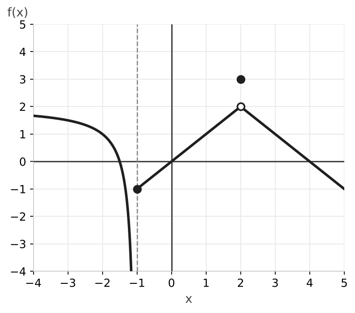

# Examen de límites y continuidad

### Ejercicio 1 (2,5 puntos) - Límites a partir de una gráfica

Observa la gráfica de la función $f(x)$. La recta discontinua $x = -1$ es una asíntota vertical.

- **a) (0,75p)** Calcula $\displaystyle\lim_{x \to -1^-} f(x)$ y $\displaystyle\lim_{x \to -1^+} f(x)$. ¿Existe el límite en $x = -1$?
- **b) (0,75p)** Calcula $\displaystyle\lim_{x \to 2^-} f(x)$ y $\displaystyle\lim_{x \to 2^+} f(x)$. ¿Existe el límite en $x = 2$? ¿Cuánto vale $f(2)$?
- **c) (1p)** Identifica y clasifica las discontinuidades de la función en $x = -1$ y en $x = 2$.

### Ejercicio 2 (3 puntos) - Cálculo de límites

Calcula los siguientes límites, indicando el tipo de indeterminación si aparece:

- **a) (1p)** $\displaystyle\lim_{x \to \infty} \frac{4x^3 - 2x + 1}{2x^3 + 5x^2}$
- **b) (1p)** $\displaystyle\lim_{x \to 3} \frac{x^2 - 9}{x - 3}$
- **c) (1p)** $\displaystyle\lim_{x \to \infty} \left(\sqrt{x^2 - 5x} - x\right)$

### Ejercicio 3 (2 puntos) - Asíntotas

Determina todas las asíntotas (verticales, horizontales u oblicuas) de la función $f(x) = \dfrac{x^2 + x}{x - 2}$.

### Ejercicio 4 (2,5 puntos) - Continuidad de una función a trozos

Estudia la continuidad de la siguiente función en $x = 1$. En caso de discontinuidad, clasifícala:

$$f(x) = \begin{cases} x^2 - x & \text{si } x < 1 \\ 3 & \text{si } x = 1 \\ 2x - 2 & \text{si } x > 1 \end{cases}$$

---

## Resolución

### Solución Ejercicio 1

**a)** Por la izquierda la gráfica baja sin límite junto a la asíntota, y por la derecha empieza en el punto $(-1, -1)$:

$$\lim_{x \to -1^-} f(x) = -\infty \qquad \lim_{x \to -1^+} f(x) = -1$$

Los límites laterales no coinciden, así que no existe el límite en $x = -1$.

**b)** Por los dos lados la gráfica se acerca al punto hueco $(2, 2)$:

$$\lim_{x \to 2^-} f(x) = 2 \qquad \lim_{x \to 2^+} f(x) = 2$$

Existe el límite y vale $2$. Sin embargo, el punto relleno indica que $f(2) = 3$.

**c)** En $x = -1$ hay una discontinuidad de salto infinito (asintótica): uno de los límites laterales es infinito.

En $x = 2$ hay una discontinuidad evitable: el límite existe ($2$) pero no coincide con el valor de la función ($f(2) = 3$).

### Solución Ejercicio 2

**a)** Al sustituir aparece una indeterminación $\dfrac{\infty}{\infty}$. El numerador y el denominador tienen el mismo grado ($3$), así que el límite es el cociente de los coeficientes principales:

$$\lim_{x \to \infty} \frac{4x^3 - 2x + 1}{2x^3 + 5x^2} = \frac{4}{2} = 2$$

**b)** Al sustituir aparece una indeterminación $\dfrac{0}{0}$. Factorizamos el numerador (diferencia de cuadrados) y simplificamos:

$$\lim_{x \to 3} \frac{(x - 3)(x + 3)}{x - 3} = \lim_{x \to 3} (x + 3) = 6$$

**c)** Aparece una indeterminación $\infty - \infty$. Multiplicamos y dividimos por el conjugado:

$$\lim_{x \to \infty} \frac{\left(\sqrt{x^2 - 5x} - x\right)\left(\sqrt{x^2 - 5x} + x\right)}{\sqrt{x^2 - 5x} + x} = \lim_{x \to \infty} \frac{x^2 - 5x - x^2}{\sqrt{x^2 - 5x} + x} = \lim_{x \to \infty} \frac{-5x}{\sqrt{x^2 - 5x} + x}$$

Ahora la indeterminación es $\dfrac{\infty}{\infty}$, con grado $1$ arriba y abajo ($\sqrt{x^2}$ se comporta como $x$). Dividimos los coeficientes principales: arriba $-5$, abajo $1 + 1 = 2$.

$$\lim_{x \to \infty} \left(\sqrt{x^2 - 5x} - x\right) = -\frac{5}{2} = -2{,}5$$

### Solución Ejercicio 3

**Asíntota vertical:** el denominador se anula en $x = 2$ y el numerador vale $2^2 + 2 = 6 \neq 0$, así que $\displaystyle\lim_{x \to 2} f(x) = \infty$. Hay asíntota vertical en $x = 2$.

**Asíntota horizontal:** $\displaystyle\lim_{x \to \infty} \frac{x^2 + x}{x - 2} = \infty$ porque el grado del numerador es mayor. No hay asíntota horizontal.

**Asíntota oblicua:** el grado del numerador supera en uno al del denominador, así que hay asíntota oblicua $y = mx + n$:

$$m = \lim_{x \to \infty} \frac{f(x)}{x} = \lim_{x \to \infty} \frac{x^2 + x}{x^2 - 2x} = 1$$

$$n = \lim_{x \to \infty} \left(f(x) - x\right) = \lim_{x \to \infty} \frac{x^2 + x - x(x - 2)}{x - 2} = \lim_{x \to \infty} \frac{3x}{x - 2} = 3$$

La asíntota oblicua es $y = x + 3$.

### Solución Ejercicio 4

Comprobamos las tres condiciones de continuidad en $x = 1$:

1. La función está definida: $f(1) = 3$.
2. Límites laterales: $\displaystyle\lim_{x \to 1^-} f(x) = 1^2 - 1 = 0$ y $\displaystyle\lim_{x \to 1^+} f(x) = 2 \cdot 1 - 2 = 0$. Coinciden, así que $\displaystyle\lim_{x \to 1} f(x) = 0$.
3. El límite ($0$) no coincide con el valor de la función ($f(1) = 3$).

La función tiene en $x = 1$ una discontinuidad evitable: bastaría redefinir $f(1) = 0$ para que fuese continua.
