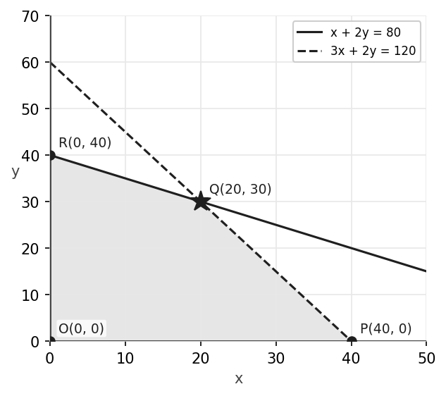
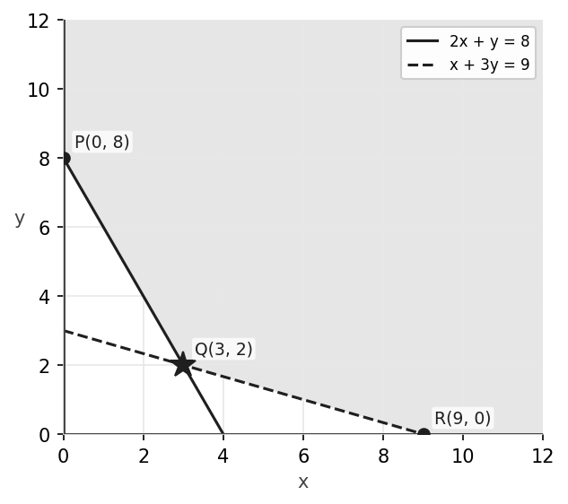
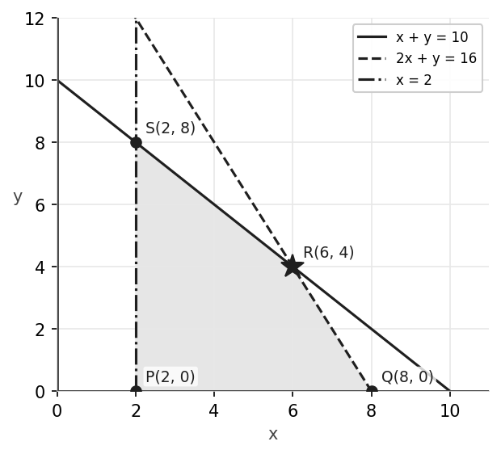
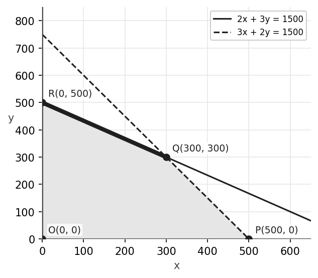
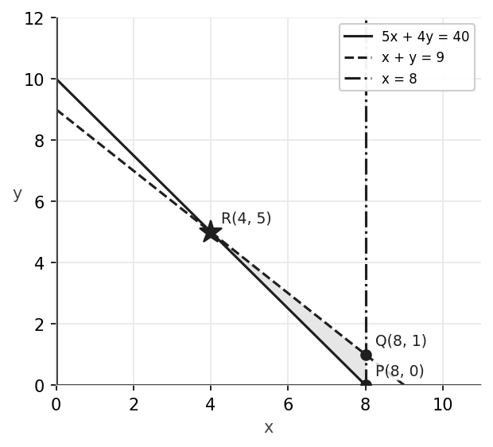

# Examen de programación lineal

### Ejercicio 1 (2 puntos) - Fábrica de bicicletas
Una fábrica produce bicicletas de paseo y de montaña. Cada bicicleta de paseo necesita $1$ kg de acero y $3$ kg de aluminio, y cada bicicleta de montaña $2$ kg de acero y $2$ kg de aluminio. Se dispone de $80$ kg de acero y $120$ kg de aluminio. El beneficio es de $20$ euros por bicicleta de paseo y $30$ euros por bicicleta de montaña.
- **a) (0,75p)** Plantea el problema de programación lineal.
- **b) (0,75p)** Representa la región factible y halla sus vértices.
- **c) (0,5p)** ¿Cuántas bicicletas de cada tipo deben fabricarse para obtener el máximo beneficio? ¿Cuál es ese beneficio?

### Ejercicio 2 (2 puntos) - Mezcla de piensos
Un ganadero alimenta a sus animales con dos piensos, $A$ y $B$. Cada kilo de pienso $A$ aporta $2$ unidades de proteínas y $1$ de grasas, y cada kilo de pienso $B$ aporta $1$ unidad de proteínas y $3$ de grasas. Cada animal necesita al día al menos $8$ unidades de proteínas y $9$ de grasas. El kilo de pienso $A$ cuesta $3$ euros y el de $B$, $2$ euros.
- **a) (0,75p)** Plantea el problema de programación lineal.
- **b) (0,75p)** Representa la región factible y halla sus vértices.
- **c) (0,5p)** ¿Qué cantidad de cada pienso minimiza el coste diario por animal? ¿Cuál es ese coste?

### Ejercicio 3 (2 puntos) - Cultivo de cereales
Un agricultor dispone de $10$ hectáreas para sembrar trigo y cebada. Cultivar una hectárea de trigo cuesta $200$ euros y una de cebada $100$ euros, y dispone de $1600$ euros. Por contrato debe sembrar al menos $2$ hectáreas de trigo. Cada hectárea de trigo le deja un beneficio de $300$ euros y cada hectárea de cebada, $200$ euros.
- **a) (0,75p)** Plantea el problema de programación lineal.
- **b) (0,75p)** Representa la región factible y halla sus vértices.
- **c) (0,5p)** ¿Cuántas hectáreas de cada cereal debe sembrar para maximizar el beneficio? ¿Cuál es ese beneficio?

### Ejercicio 4 (2 puntos) - Taller de joyería
Un taller fabrica anillos y pulseras. Un anillo necesita $2$ g de oro y $3$ g de plata, y una pulsera $3$ g de oro y $2$ g de plata. Cada mes dispone de $1500$ g de oro y $1500$ g de plata. Gana $40$ euros por anillo y $60$ euros por pulsera.
- **a) (0,75p)** Plantea el problema de programación lineal.
- **b) (0,75p)** Representa la región factible y halla sus vértices.
- **c) (0,5p)** ¿Cuántos anillos y pulseras debe fabricar para maximizar el beneficio? ¿Es única la solución?

### Ejercicio 5 (2 puntos) - Excursión escolar
Un colegio organiza una excursión para $400$ alumnos. La empresa de transporte tiene $8$ autobuses de $50$ plazas y $10$ de $40$ plazas, pero solo dispone de $9$ conductores. Alquilar un autobús grande cuesta $800$ euros y uno pequeño $600$ euros.
- **a) (0,75p)** Plantea el problema de programación lineal.
- **b) (0,75p)** Representa la región factible y halla sus vértices.
- **c) (0,5p)** ¿Cuántos autobuses de cada tipo deben alquilarse para que la excursión resulte lo más barata posible? ¿Cuál es el coste?

---

## Resolución

### Solución Ejercicio 1
**a)** Sean $x$ las bicicletas de paseo e $y$ las de montaña. Maximizar $B(x,y)=20x+30y$ sujeto a:
$$\begin{cases}x+2y\le 80\\3x+2y\le 120\\x\ge 0,\ y\ge 0\end{cases}$$

**b)** Las rectas $x+2y=80$ y $3x+2y=120$ se cortan en: restando, $2x=40$, así que $x=20$, $y=30$.
La región factible es el cuadrilátero de vértices $O(0,0)$, $P(40,0)$, $Q(20,30)$ y $R(0,40)$.

**c)** Evaluamos la función objetivo en los vértices:
$$B(0,0)=0,\quad B(40,0)=800,\quad B(20,30)=1300,\quad B(0,40)=1200$$
El máximo beneficio, $1300$ euros, se obtiene fabricando $20$ bicicletas de paseo y $30$ de montaña.

### Solución Ejercicio 2
**a)** Sean $x$ los kilos de pienso $A$ e $y$ los de pienso $B$. Minimizar $C(x,y)=3x+2y$ sujeto a:
$$\begin{cases}2x+y\ge 8\\x+3y\ge 9\\x\ge 0,\ y\ge 0\end{cases}$$

**b)** Las rectas $2x+y=8$ y $x+3y=9$ se cortan en: de la segunda, $x=9-3y$; sustituyendo, $18-6y+y=8$, así que $y=2$, $x=3$.
La región factible es no acotada, con vértices $P(0,8)$, $Q(3,2)$ y $R(9,0)$.

**c)** Evaluamos la función objetivo en los vértices:
$$C(0,8)=16,\quad C(3,2)=13,\quad C(9,0)=27$$
Como los coeficientes de $C$ son positivos y la región se extiende hacia valores mayores de $x$ e $y$, el mínimo existe y está en un vértice: el coste mínimo es $13$ euros, con $3$ kg de pienso $A$ y $2$ kg de pienso $B$.

### Solución Ejercicio 3
**a)** Sean $x$ las hectáreas de trigo e $y$ las de cebada. Maximizar $B(x,y)=300x+200y$ sujeto a:
$$\begin{cases}x+y\le 10\\200x+100y\le 1600\\x\ge 2\\y\ge 0\end{cases}$$
La segunda restricción simplificada es $2x+y\le 16$.

**b)** Vértices:
1. $x=2$ con $y=0$: $P(2,0)$.
2. $2x+y=16$ con $y=0$: $Q(8,0)$.
3. $x+y=10$ con $2x+y=16$: restando, $x=6$, $y=4$: $R(6,4)$.
4. $x=2$ con $x+y=10$: $S(2,8)$.

**c)** Evaluamos la función objetivo en los vértices:
$$B(2,0)=600,\quad B(8,0)=2400,\quad B(6,4)=2600,\quad B(2,8)=2200$$
El máximo beneficio, $2600$ euros, se obtiene sembrando $6$ hectáreas de trigo y $4$ de cebada.

### Solución Ejercicio 4
**a)** Sean $x$ los anillos e $y$ las pulseras. Maximizar $B(x,y)=40x+60y$ sujeto a:
$$\begin{cases}2x+3y\le 1500\\3x+2y\le 1500\\x\ge 0,\ y\ge 0\end{cases}$$

**b)** Las rectas $2x+3y=1500$ y $3x+2y=1500$ se cortan en: sumando, $5x+5y=3000$, así que $x+y=600$; restando, $x-y=0$. Luego $x=y=300$.
La región factible es el cuadrilátero de vértices $O(0,0)$, $P(500,0)$, $Q(300,300)$ y $R(0,500)$.

**c)** Evaluamos la función objetivo en los vértices:
$$B(0,0)=0,\quad B(500,0)=20000,\quad B(300,300)=30000,\quad B(0,500)=30000$$
El máximo, $30000$ euros, se alcanza en dos vértices, así que la solución no es única: se alcanza en todos los puntos del segmento $\overline{QR}$, porque la función objetivo $40x+60y=20(2x+3y)$ es paralela a la restricción del oro.
Las soluciones con número entero de piezas son los puntos de ese segmento con coordenadas enteras, por ejemplo $(0,500)$, $(3,498)$, $(150,400)$ o $(300,300)$.

### Solución Ejercicio 5
**a)** Sean $x$ los autobuses grandes e $y$ los pequeños. Minimizar $C(x,y)=800x+600y$ sujeto a:
$$\begin{cases}50x+40y\ge 400\\x+y\le 9\\0\le x\le 8\\0\le y\le 10\end{cases}$$
La primera restricción simplificada es $5x+4y\ge 40$.

**b)** Vértices:
1. $x=8$ con $5x+4y=40$: $y=0$, $P(8,0)$.
2. $x=8$ con $x+y=9$: $Q(8,1)$.
3. $x+y=9$ con $5x+4y=40$: $5x+4(9-x)=40$, así que $x=4$, $y=5$: $R(4,5)$.

La restricción $y\le 10$ no influye, porque $x+y\le 9$ ya obliga a $y\le 9$. La región factible es el triángulo $PQR$.

**c)** Evaluamos la función objetivo en los vértices:
$$C(8,0)=6400,\quad C(8,1)=7000,\quad C(4,5)=6200$$
El coste mínimo, $6200$ euros, se obtiene alquilando $4$ autobuses grandes y $5$ pequeños.
