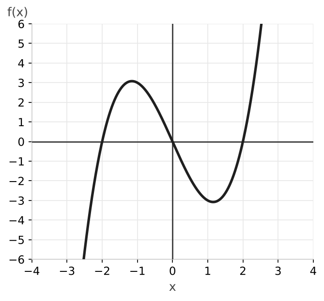
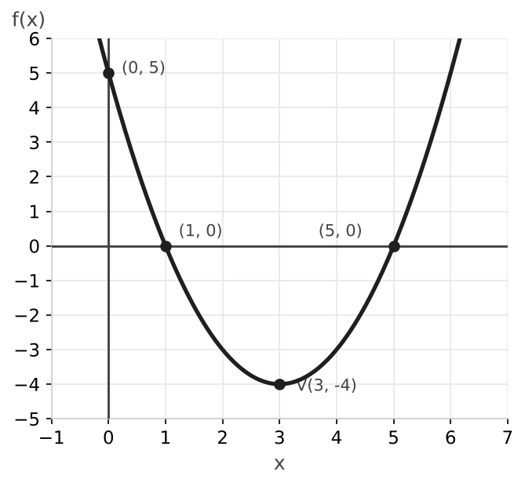

# Examen de funciones y funciones elementales

### Ejercicio 1 (2,5 puntos) - Dominio, cortes y signo

Dada la función racional $f(x) = \dfrac{1}{x - 1}$:

- **a) (0,75p)** Determina razonadamente su dominio.
- **b) (0,75p)** Encuentra los puntos de corte con los ejes de coordenadas.
- **c) (1p)** Estudia el signo de la función en todo su dominio.

### Ejercicio 2 (2,5 puntos) - Estudio de una gráfica

Observa la siguiente gráfica de una función $f(x)$:

A partir de la gráfica, determina:

- **a) (0,5p)** El dominio y el recorrido (imagen) de la función.
- **b) (0,75p)** Los intervalos de crecimiento y decrecimiento.
- **c) (0,75p)** Las coordenadas aproximadas de sus máximos y mínimos relativos.
- **d) (0,5p)** ¿Qué tipo de simetría presenta la función (par, impar o ninguna)? Justifica tu respuesta.

### Ejercicio 3 (2,5 puntos) - Función cuadrática

Dada la parábola $f(x) = x^2 - 6x + 5$:

- **a) (0,75p)** Calcula las coordenadas de su vértice.
- **b) (0,75p)** Halla los puntos de corte con el eje $X$ y con el eje $Y$.
- **c) (1p)** Representa la función de forma aproximada usando los apartados anteriores. ¿Es cóncava o convexa?

### Ejercicio 4 (2,5 puntos) - Funciones radicales, logarítmicas y exponenciales

- **a) (0,75p)** Determina el dominio de la función $h(x) = \sqrt{x + 4}$.
- **b) (0,75p)** Determina el dominio de la función $g(x) = \log(2x - 8)$.
- **c) (1p)** Indica cuál es la asíntota de la función $f(x) = 2^x - 3$. ¿Es creciente o decreciente?

---

## Resolución

### Solución Ejercicio 1

**a)** Al tratarse de una fracción, el denominador no puede valer $0$:

$$x - 1 = 0 \implies x = 1$$

El dominio es $\mathbb{R} \setminus \{1\}$, es decir, todos los números reales excepto el $1$.

**b)** Corte con el eje $X$ (hacemos $f(x) = 0$): una fracción solo vale $0$ si su numerador vale $0$, y el numerador es $1 \neq 0$. Por tanto, no corta al eje $X$.

Corte con el eje $Y$ (hacemos $x = 0$): $f(0) = \dfrac{1}{0 - 1} = -1$. El punto de corte es $(0, -1)$.

**c)** El único punto donde la función puede cambiar de signo es $x = 1$ (no hay ceros). Probamos un valor en cada intervalo:

- En $(-\infty, 1)$: $f(0) = -1 < 0$, la función es negativa.
- En $(1, +\infty)$: $f(2) = 1 > 0$, la función es positiva.

### Solución Ejercicio 2

**a)** Dominio: $\mathbb{R}$. Recorrido: $\mathbb{R}$ (la gráfica baja hasta $-\infty$ y sube hasta $+\infty$).

**b)** Crece en $(-\infty; -1{,}15) \cup (1{,}15; +\infty)$ y decrece en $(-1{,}15; 1{,}15)$, aproximadamente.

**c)** Máximo relativo en $(-1{,}15; 3{,}1)$ y mínimo relativo en $(1{,}15; -3{,}1)$, aproximadamente.

**d)** Es impar: la gráfica es simétrica respecto al origen. Cada punto $(x, y)$ tiene su simétrico $(-x, -y)$; por ejemplo, el máximo y el mínimo son simétricos. Es decir, $f(-x) = -f(x)$.

### Solución Ejercicio 3

**a)** Con $a = 1$, $b = -6$, $c = 5$:

$$x_v = \frac{-b}{2a} = \frac{6}{2} = 3 \qquad f(3) = 9 - 18 + 5 = -4$$

El vértice es $V(3, -4)$.

**b)** Eje $X$ (hacemos $f(x) = 0$):

$$x^2 - 6x + 5 = 0 \implies x = \frac{6 \pm \sqrt{36 - 20}}{2} = \frac{6 \pm 4}{2} \implies x_1 = 5, \quad x_2 = 1$$

Puntos $(1, 0)$ y $(5, 0)$. Eje $Y$: $f(0) = 5$, punto $(0, 5)$.

**c)** Como $a = 1 > 0$, las ramas van hacia arriba: la función es convexa y el vértice es un mínimo.

### Solución Ejercicio 4

**a)** El radicando de una raíz cuadrada no puede ser negativo:

$$x + 4 \geq 0 \implies x \geq -4$$

Dominio: $[-4, +\infty)$.

**b)** El argumento de un logaritmo debe ser positivo:

$$2x - 8 > 0 \implies 2x > 8 \implies x > 4$$

Dominio: $(4, +\infty)$.

**c)** La función $y = 2^x$ tiene una asíntota horizontal en $y = 0$. Al restarle $3$, la gráfica baja $3$ unidades y la asíntota pasa a ser $y = -3$. Como la base es $2 > 1$, la función es creciente.
