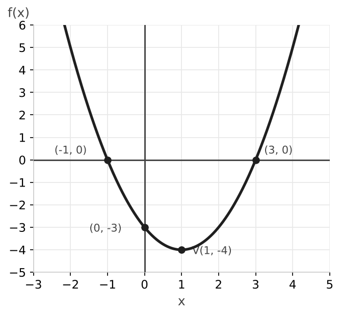

# Examen de funciones y funciones elementales

### Ejercicio 1 (2,5 puntos) - Dominio, cortes y signo

Dada la función racional $f(x) = \dfrac{x + 4}{x - 2}$:

- **a) (0,75p)** Determina razonadamente su dominio.
- **b) (0,75p)** Encuentra los puntos de corte con los ejes de coordenadas.
- **c) (1p)** Estudia el signo de la función en todo su dominio.

### Ejercicio 2 (2,5 puntos) - Estudio de una parábola

La gráfica de una función $g(x)$ es una parábola que abre hacia abajo, con vértice en $(0, 4)$, y que pasa por los puntos $(-2, 0)$ y $(2, 0)$.

- **a) (0,5p)** Determina el dominio y el recorrido (imagen) de la función.
- **b) (0,75p)** Indica los intervalos de crecimiento y decrecimiento.
- **c) (0,5p)** Identifica las coordenadas de su máximo absoluto.
- **d) (0,75p)** Determina si presenta simetría (par, impar o ninguna) y justifica la respuesta.

### Ejercicio 3 (2,5 puntos) - Función cuadrática

Dada la parábola $f(x) = x^2 - 2x - 3$:

- **a) (0,75p)** Calcula las coordenadas de su vértice.
- **b) (0,75p)** Halla los puntos de corte con el eje $X$ y con el eje $Y$.
- **c) (1p)** Representa la función de forma aproximada. ¿Es cóncava o convexa?

### Ejercicio 4 (2,5 puntos) - Funciones radicales, logarítmicas y exponenciales

- **a) (0,75p)** Determina el dominio de la función $h(x) = \sqrt{x - 3}$.
- **b) (0,75p)** Determina el dominio de la función $g(x) = \log(2x - 8)$.
- **c) (1p)** Indica cuál es la asíntota de la función $f(x) = 2^x - 3$. ¿Es creciente o decreciente?

---

## Resolución

### Solución Ejercicio 1

**a)** El denominador no puede valer $0$: $x - 2 = 0 \implies x = 2$. El dominio es $\mathbb{R} \setminus \{2\}$.

**b)** Eje $X$: el numerador debe valer $0$, $x + 4 = 0 \implies x = -4$. Punto $(-4, 0)$.

Eje $Y$: $f(0) = \dfrac{4}{-2} = -2$. Punto $(0, -2)$.

**c)** Los puntos que separan los intervalos son el cero $x = -4$ y el punto fuera del dominio $x = 2$. Probamos un valor en cada intervalo:

- En $(-\infty, -4)$: $f(-5) = \dfrac{-1}{-7} > 0$, positiva.
- En $(-4, 2)$: $f(0) = -2 < 0$, negativa.
- En $(2, +\infty)$: $f(3) = \dfrac{7}{1} > 0$, positiva.

La función es positiva en $(-\infty, -4) \cup (2, +\infty)$ y negativa en $(-4, 2)$.

### Solución Ejercicio 2

**a)** Dominio: $\mathbb{R}$. Como la parábola abre hacia abajo y su punto más alto es el vértice, el recorrido es $(-\infty, 4]$.

**b)** Crece en $(-\infty, 0)$ y decrece en $(0, +\infty)$.

**c)** El máximo absoluto está en el vértice: $(0, 4)$.

**d)** Es par: la gráfica es simétrica respecto al eje $Y$, ya que el vértice está sobre ese eje. Se cumple $g(-x) = g(x)$; por ejemplo, $g(-2) = g(2) = 0$.

### Solución Ejercicio 3

**a)** Con $a = 1$, $b = -2$, $c = -3$:

$$x_v = \frac{-b}{2a} = \frac{2}{2} = 1 \qquad f(1) = 1 - 2 - 3 = -4$$

El vértice es $V(1, -4)$.

**b)** Eje $X$:

$$x^2 - 2x - 3 = 0 \implies x = \frac{2 \pm \sqrt{4 + 12}}{2} = \frac{2 \pm 4}{2} \implies x_1 = 3, \quad x_2 = -1$$

Puntos $(-1, 0)$ y $(3, 0)$. Eje $Y$: $f(0) = -3$, punto $(0, -3)$.

**c)** Como $a = 1 > 0$, las ramas van hacia arriba: la función es convexa y el vértice es un mínimo.

### Solución Ejercicio 4

**a)** El radicando no puede ser negativo: $x - 3 \geq 0 \implies x \geq 3$. Dominio: $[3, +\infty)$.

**b)** El argumento del logaritmo debe ser positivo: $2x - 8 > 0 \implies x > 4$. Dominio: $(4, +\infty)$.

**c)** La función $y = 2^x$ tiene una asíntota horizontal en $y = 0$; al restarle $3$, la asíntota baja a $y = -3$. Como la base es $2 > 1$, la función es creciente.
