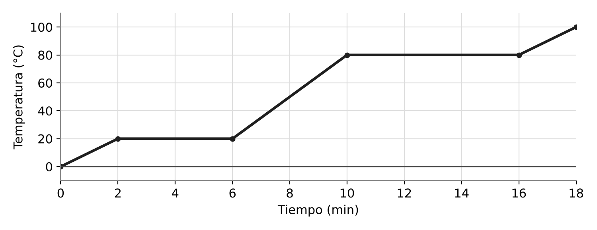
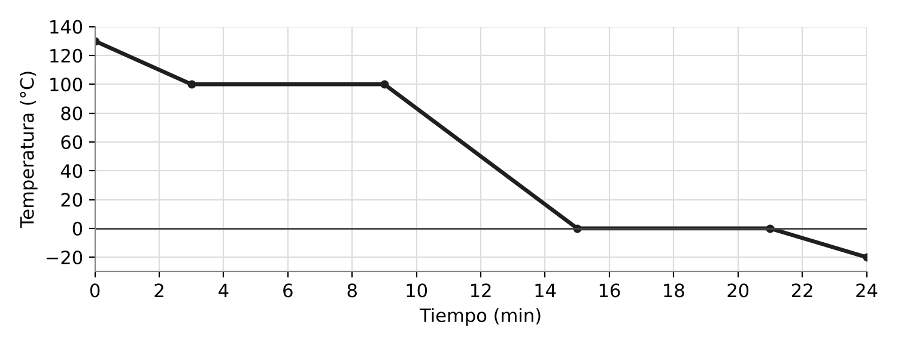

# Examen de la materia y sus cambios de estado
### Ejercicio 1 (2 puntos) - Cambios de estado
Indica si cada afirmación es verdadera (V) o falsa (F) y razona tu respuesta. Si es falsa, corrígela.
- **a) (0,5p)** La sublimación es el paso directo de sólido a gas, sin pasar por el estado líquido.
- **b) (0,5p)** Mientras el agua está hirviendo, su temperatura sigue subiendo porque la seguimos calentando.
- **c) (0,5p)** El agua solo se evapora cuando alcanza los $100\ \text{°C}$.
- **d) (0,5p)** La condensación es un cambio de estado progresivo, porque para que ocurra hay que aportar calor.
### Ejercicio 2 (2 puntos) - Estados de agregación
- **a) (1p)** Indica el estado (sólido, líquido o gas) en que se encuentran a temperatura ambiente (unos $20\ \text{°C}$) las siguientes sustancias: sal común, aceite de oliva, dióxido de carbono, vinagre, madera, helio, leche, azúcar, aluminio y nitrógeno.

Conociendo su punto de fusión (PF) y su punto de ebullición (PE), indica el estado de cada sustancia a las temperaturas que se piden:
- **b) (0,25p)** Etanol (PF $= -114\ \text{°C}$, PE $= 78\ \text{°C}$): a $20\ \text{°C}$ y a $100\ \text{°C}$.
- **c) (0,25p)** Hierro (PF $= 1538\ \text{°C}$, PE $= 2862\ \text{°C}$): a $20\ \text{°C}$ y a $2000\ \text{°C}$.
- **d) (0,25p)** Oxígeno (PF $= -218\ \text{°C}$, PE $= -183\ \text{°C}$): a $20\ \text{°C}$ y a $-200\ \text{°C}$.
- **e) (0,25p)** Mercurio (PF $= -39\ \text{°C}$, PE $= 357\ \text{°C}$): a $-50\ \text{°C}$ y a $20\ \text{°C}$.
### Ejercicio 3 (2 puntos) - Unidades compuestas
Expresa las siguientes magnitudes en unidades del Sistema Internacional usando factores de conversión. Indica en cada caso cuál es la unidad del SI.
- **a) (0,5p)** Un guepardo puede correr a $108\ \text{km/h}$.
- **b) (0,5p)** La densidad del aceite de oliva es $0{,}92\ \text{g/cm}^3$.
- **c) (0,5p)** Un grifo abierto deja salir $18\ \text{L/min}$ de agua.
- **d) (0,5p)** La densidad del aire es $1{,}3\ \text{g/L}$.
### Ejercicio 4 (2 puntos) - Gráficas de cambio de estado
La siguiente gráfica muestra cómo cambia la temperatura de una sustancia pura al calentarla. Al principio la sustancia está en estado sólido.

- **a) (0,25p)** ¿Cuáles son su punto de fusión y su punto de ebullición?
- **b) (0,25p)** ¿En qué estado se encuentra la sustancia en los minutos $1$, $8$ y $17$?
- **c) (0,25p)** ¿Qué ocurre en los tramos horizontales? ¿Por qué no cambia la temperatura aunque se siga calentando?
- **d) (0,25p)** ¿En qué estado estará esta sustancia a temperatura ambiente ($25\ \text{°C}$)?

Esta otra gráfica muestra cómo cambia la temperatura de otra sustancia pura al enfriarla. Al principio la sustancia está en estado gaseoso.

- **e) (0,25p)** ¿Qué cambios de estado se producen y a qué temperatura ocurre cada uno?
- **f) (0,25p)** ¿Cuántos minutos dura cada cambio de estado?
- **g) (0,25p)** ¿En qué estado se encuentra la sustancia en el minuto $12$? ¿Y en el minuto $18$?
- **h) (0,25p)** ¿De qué sustancia puede tratarse? Razona tu respuesta.
### Ejercicio 5 (2 puntos) - Clasificación de la materia
- **a) (1,6p)** Clasifica cada sistema material como sustancia pura (elemento o compuesto) o como mezcla (homogénea o heterogénea): oro, agua destilada, aire, granito, sal común (cloruro de sodio), agua del mar, oxígeno y ensalada.
- **b) (0,4p)** Tenemos dos líquidos transparentes e incoloros y no sabemos cuál es una sustancia pura y cuál una mezcla. ¿Cómo podríamos distinguirlos calentándolos hasta que hiervan? Razona tu respuesta.
---
## Resolución
### Solución Ejercicio 1
**a)** Verdadera. La sublimación es el paso directo de sólido a gas, como ocurre con la naftalina o el hielo seco. El paso contrario, de gas a sólido, se llama sublimación inversa.
**b)** Falsa. Durante un cambio de estado la temperatura de una sustancia pura se mantiene constante: todo el calor que se aporta se usa en separar las partículas, no en aumentar su temperatura. El agua hierve a $100\ \text{°C}$ (a nivel del mar) y se mantiene a esa temperatura hasta que se ha evaporado toda.
**c)** Falsa. La evaporación ocurre a cualquier temperatura y solo en la superficie del líquido (por eso la ropa tendida se seca). A $100\ \text{°C}$ lo que ocurre es la ebullición, que se produce en todo el líquido a la vez.
**d)** Falsa. La condensación (paso de gas a líquido) es un cambio de estado regresivo: para que ocurra hay que quitar calor a la sustancia, es decir, enfriarla. Los cambios progresivos (fusión, vaporización y sublimación) son los que necesitan que se aporte calor.
### Solución Ejercicio 2
**a)** A unos $20\ \text{°C}$:
- Sólidos: sal común, madera, azúcar y aluminio.
- Líquidos: aceite de oliva, vinagre y leche.
- Gases: dióxido de carbono, helio y nitrógeno.

Una sustancia es sólida si la temperatura es menor que su PF, líquida si está entre el PF y el PE, y gas si es mayor que su PE.
**b)** Etanol: a $20\ \text{°C}$ es líquido ($-114 < 20 < 78$) y a $100\ \text{°C}$ es gas ($100 > 78$).
**c)** Hierro: a $20\ \text{°C}$ es sólido ($20 < 1538$) y a $2000\ \text{°C}$ es líquido ($1538 < 2000 < 2862$).
**d)** Oxígeno: a $20\ \text{°C}$ es gas ($20 > -183$) y a $-200\ \text{°C}$ es líquido ($-218 < -200 < -183$).
**e)** Mercurio: a $-50\ \text{°C}$ es sólido ($-50 < -39$) y a $20\ \text{°C}$ es líquido ($-39 < 20 < 357$).
### Solución Ejercicio 3
**a)** La velocidad se mide en el SI en metros por segundo ($\text{m/s}$). Cambiamos los kilómetros a metros y las horas a segundos:
$$108\ \frac{\text{km}}{\text{h}} \cdot \frac{1000\ \text{m}}{1\ \text{km}} \cdot \frac{1\ \text{h}}{3600\ \text{s}} = \frac{108\,000}{3600}\ \frac{\text{m}}{\text{s}} = 30\ \text{m/s}$$
**b)** La densidad se mide en el SI en kilogramos por metro cúbico ($\text{kg/m}^3$). Como $1\ \text{m}^3 = 1\,000\,000\ \text{cm}^3$:
$$0{,}92\ \frac{\text{g}}{\text{cm}^3} \cdot \frac{1\ \text{kg}}{1000\ \text{g}} \cdot \frac{1\,000\,000\ \text{cm}^3}{1\ \text{m}^3} = 920\ \text{kg/m}^3$$
**c)** El caudal se mide en el SI en metros cúbicos por segundo ($\text{m}^3/\text{s}$). Como $1\ \text{m}^3 = 1000\ \text{L}$ y $1\ \text{min} = 60\ \text{s}$:
$$18\ \frac{\text{L}}{\text{min}} \cdot \frac{1\ \text{m}^3}{1000\ \text{L}} \cdot \frac{1\ \text{min}}{60\ \text{s}} = \frac{18}{60\,000}\ \frac{\text{m}^3}{\text{s}} = 0{,}0003\ \text{m}^3/\text{s} = 3 \cdot 10^{-4}\ \text{m}^3/\text{s}$$
**d)** De nuevo es una densidad, así que la pasamos a $\text{kg/m}^3$. Como $1\ \text{m}^3 = 1000\ \text{L}$:
$$1{,}3\ \frac{\text{g}}{\text{L}} \cdot \frac{1\ \text{kg}}{1000\ \text{g}} \cdot \frac{1000\ \text{L}}{1\ \text{m}^3} = 1{,}3\ \text{kg/m}^3$$
### Solución Ejercicio 4
**a)** Los tramos horizontales marcan los cambios de estado. El punto de fusión es $20\ \text{°C}$ (primer tramo horizontal) y el punto de ebullición es $80\ \text{°C}$ (segundo tramo horizontal).
**b)** En el minuto $1$ la temperatura no ha llegado a $20\ \text{°C}$, así que es sólido. En el minuto $8$ está entre $20\ \text{°C}$ y $80\ \text{°C}$: es líquido. En el minuto $17$ ya ha superado los $80\ \text{°C}$: es gas.
**c)** En los tramos horizontales la sustancia está cambiando de estado: entre los minutos $2$ y $6$ se funde y entre los minutos $10$ y $16$ hierve. Durante ese tiempo conviven dos estados. La temperatura no cambia porque el calor que se aporta se emplea en romper las uniones entre las partículas y no en aumentar su temperatura.
**d)** $25\ \text{°C}$ está entre el punto de fusión ($20\ \text{°C}$) y el de ebullición ($80\ \text{°C}$), así que a temperatura ambiente la sustancia es líquida.
**e)** Hay dos tramos horizontales:
1. A $100\ \text{°C}$ se produce la condensación (de gas a líquido).
2. A $0\ \text{°C}$ se produce la solidificación (de líquido a sólido).

**f)** La condensación dura desde el minuto $3$ hasta el $9$, es decir, $9 - 3 = 6$ minutos. La solidificación dura desde el minuto $15$ hasta el $21$: $21 - 15 = 6$ minutos.
**g)** En el minuto $12$ la sustancia está entre $100\ \text{°C}$ y $0\ \text{°C}$, después de condensarse y antes de solidificarse, así que es líquida. En el minuto $18$ se está solidificando, de modo que conviven el estado líquido y el sólido.
**h)** Se trata del agua, porque es la sustancia pura que tiene su punto de ebullición a $100\ \text{°C}$ y su punto de fusión a $0\ \text{°C}$.
### Solución Ejercicio 5
**a)**
- Oro: sustancia pura, elemento (un solo tipo de átomo, $\text{Au}$).
- Agua destilada: sustancia pura, compuesto ($\text{H}_2\text{O}$, formado por hidrógeno y oxígeno).
- Aire: mezcla homogénea (nitrógeno, oxígeno y otros gases; no se distinguen sus componentes).
- Granito: mezcla heterogénea (se ven a simple vista sus granos de cuarzo, feldespato y mica).
- Sal común: sustancia pura, compuesto ($\text{NaCl}$, formado por sodio y cloro).
- Agua del mar: mezcla homogénea (agua con sales disueltas; a simple vista no se distinguen).
- Oxígeno: sustancia pura, elemento ($\text{O}_2$, un solo tipo de átomo).
- Ensalada: mezcla heterogénea (se distinguen claramente sus componentes).

**b)** Los calentamos y medimos la temperatura mientras hierven. La sustancia pura hierve a una temperatura fija que se mantiene constante durante toda la ebullición (su gráfica tiene un tramo horizontal). En la mezcla, en cambio, la temperatura sigue variando mientras hierve, porque sus componentes tienen distintos puntos de ebullición.
